# Probabilistic Models: EM, Gibbs Sampling and Metropolis-Hastings

Latent-variable models and Bayesian inference **from scratch in R**: the EM algorithm for Gaussian mixtures,
MCMC samplers (Gibbs, random-walk Metropolis-Hastings, tempering), and a review of a NeurIPS 2019 paper on
multimodal MCMC.

These are the building blocks behind modern generative models: latent variables and the EM / ELBO view
(VAEs), and MCMC / Langevin-type sampling (energy-based and diffusion models).

> Team coursework (4 students), M2 Statistics, Sorbonne University, 2022–2023.

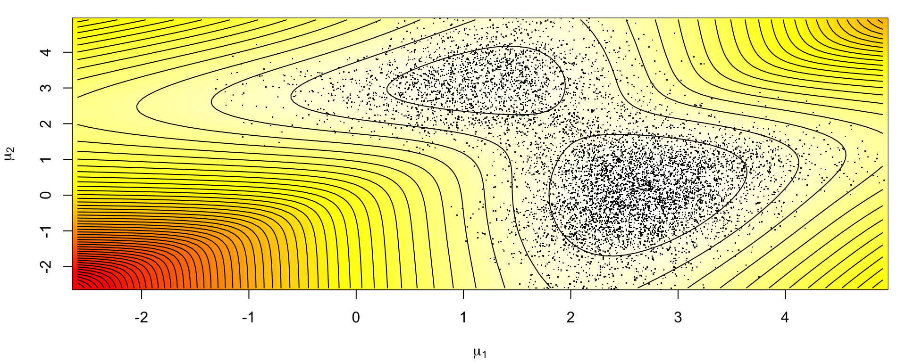

## Contents

| File | What it does |
|---|---|
| [`em_gaussian_mixture.R`](em_gaussian_mixture.R) | EM for a K-component Gaussian mixture (E-step / M-step in closed form), MAP classification, choice of K by BIC |
| [`gibbs_gaussian_mixture.R`](gibbs_gaussian_mixture.R) | Bayesian Gaussian mixture with conjugate priors, Gibbs sampler by data augmentation, log-posterior surface; Gibbs sampling of a correlated Gaussian |
| [`metropolis_hastings.R`](metropolis_hastings.R) | Random-walk Metropolis-Hastings: proposal-scale tuning, posterior of mixture means, tempering to escape a spurious mode |
| [`pseudo_extended_mcmc_review.md`](pseudo_extended_mcmc_review.md) | Review of *Pseudo-Extended MCMC* (Nemeth et al., NeurIPS 2019) |

## 1. EM algorithm for Gaussian mixtures

For $f(x) = \sum_k p_k\, \varphi(x; \mu_k, \sigma_k^2)$, EM alternates

- **E-step**: $t_{ik} = P(z_i = k \mid x_i, \theta) = \dfrac{p_k \varphi(x_i;\mu_k,\sigma_k^2)}{\sum_l p_l \varphi(x_i;\mu_l,\sigma_l^2)}$
- **M-step**: $p_k = \frac{1}{n}\sum_i t_{ik}$, $\mu_k = \dfrac{\sum_i t_{ik}x_i}{\sum_i t_{ik}}$, $\sigma_k^2 = \dfrac{\sum_i t_{ik}(x_i-\mu_k)^2}{\sum_i t_{ik}}$

until the log-likelihood stops increasing. The number of components is selected by BIC.
Model-based clustering in higher dimension was also studied with [Rmixmod](https://cran.r-project.org/package=Rmixmod)
(14 covariance structures, BIC / ICL criteria).

| 2D model-based clustering (3 components) | BIC of the covariance models vs number of components |
|---|---|
| 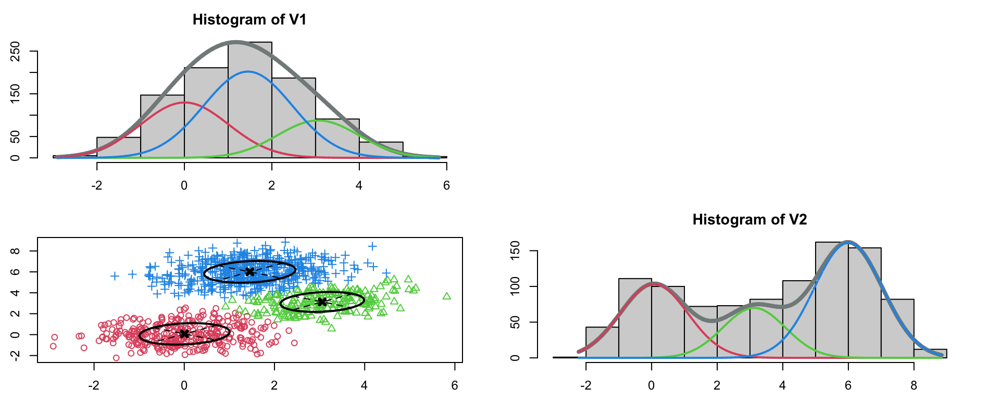 | 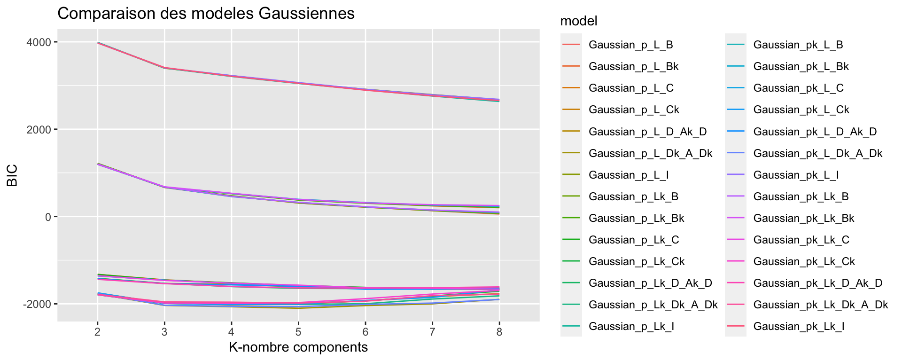 |

## 2. Gibbs sampler for a Bayesian Gaussian mixture

Conjugate priors $\pi \sim \mathcal D(\gamma)$, $\sigma_k^2 \sim \mathcal{IG}(\lambda_k/2, \beta_k/2)$,
$\mu_k \mid \sigma_k^2 \sim \mathcal N(\alpha_k, \sigma_k^2/\lambda_k)$. The sampler alternates the latent labels
$z \mid x, \theta$ and the parameters $\theta \mid z, x$, all available in closed form.
Posterior draws concentrate on the mode of the log-posterior of $(\mu_1, \mu_2)$ (true values $-1.58$ and $0.99$).

| Gibbs samples on the log-posterior | Posterior of $\mu_1, \mu_2$ | Gibbs sampling of a correlated Gaussian ($\rho = 0.5$) |
|---|---|---|
| 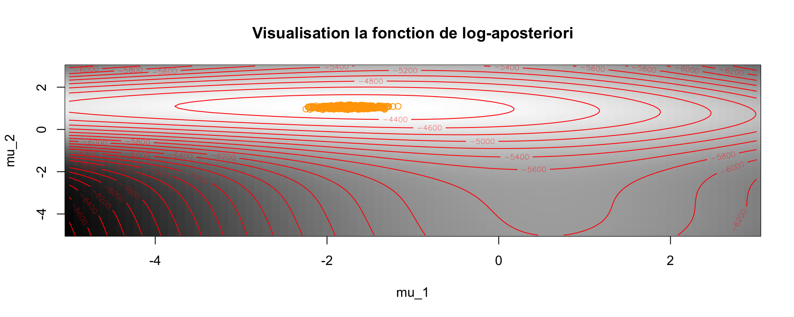 | 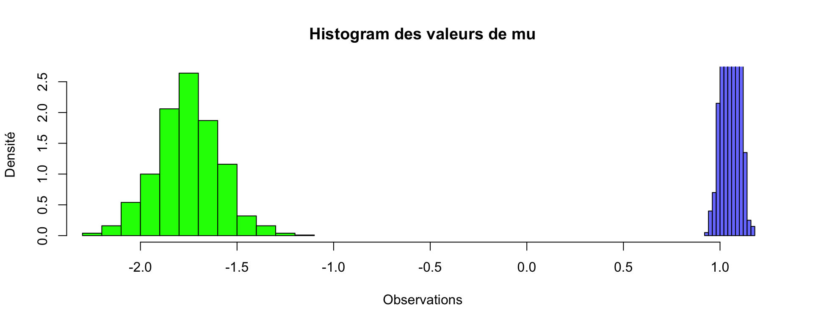 | 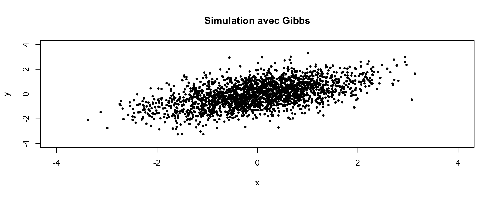 |

## 3. Metropolis-Hastings and tempering

**Tuning the proposal** on the bimodal target $0.3\,\mathcal N(-2,1) + 0.7\,\mathcal N(5,1)$ (true density in navy,
MCMC estimate in turquoise):

| sd = 0.1: acceptance 97%, stuck in one mode | sd = 10: acceptance 20%, both modes | sd = 100: acceptance 2%, too many rejections |
|---|---|---|
| 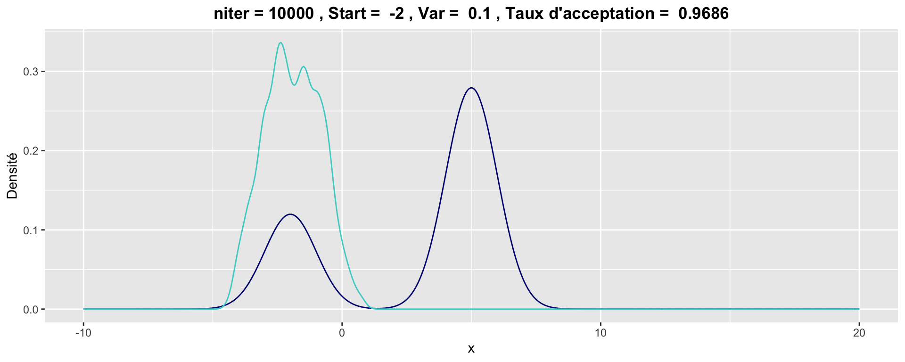 | 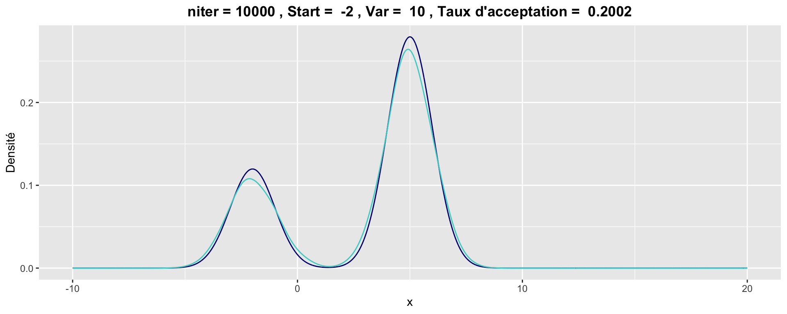 | 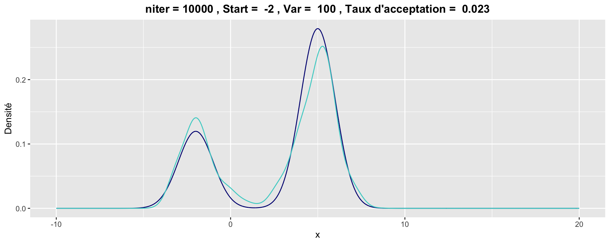 |

**Tempering**: targeting $\pi^\alpha$ flattens the posterior of the mixture means. Started next to the spurious mode,
the chain never leaves it for $\alpha = 1$, while for $\alpha = 0.01$ it reaches the main mode within a few iterations.
This is the same multimodality problem that motivates the pseudo-extended method reviewed below.

| $\alpha = 1$ | $\alpha = 0.1$ | $\alpha = 0.01$ |
|---|---|---|
| 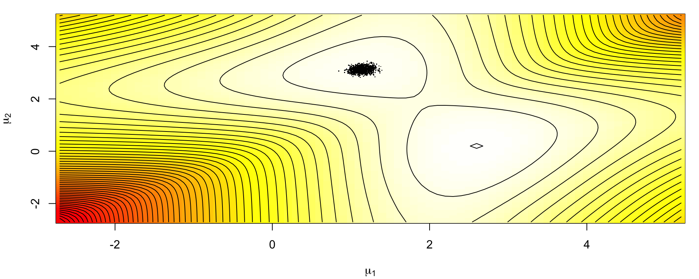 | 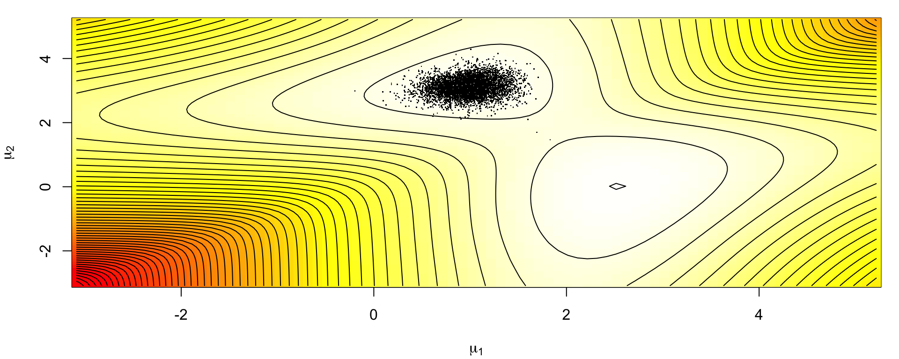 |  |

## 4. Research review: Pseudo-Extended MCMC

[Full review](pseudo_extended_mcmc_review.md). The state space is augmented with $N$ pseudo-samples and an
auxiliary density $q$ that only needs to be **evaluated**, not sampled. On the extended space the posterior modes
are connected, so HMC moves easily between them; self-normalized importance weights then give unbiased estimates
under the original target.

## Usage

```r
install.packages(c("gtools", "mvtnorm", "bayess"))
source("em_gaussian_mixture.R")
source("gibbs_gaussian_mixture.R")
source("metropolis_hastings.R")
```

## Credits

- Gibbs sampler adapted from the course notes of the "Latent structure models" class (Sorbonne University).
- Tempering experiment and `plotmix()` from J.-M. Marin & C. P. Robert, *Bayesian Essentials with R* (Springer, 2014), R package `bayess`.
- Figures come from the original lab reports. The scripts are a cleaned-up English version of the lab code.
